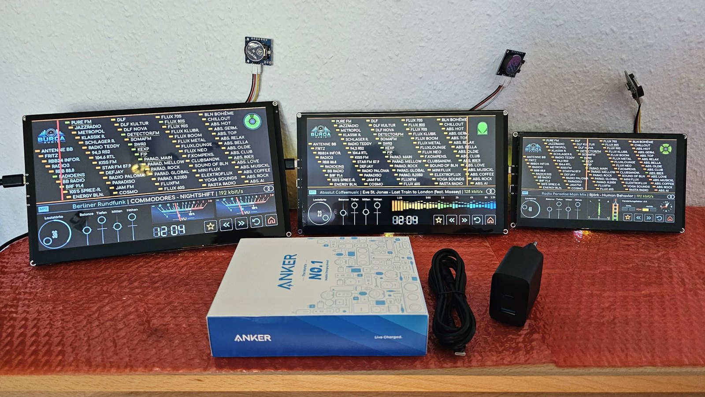
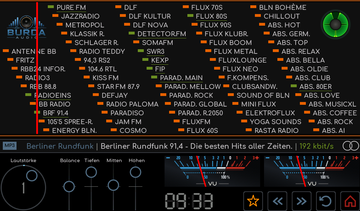
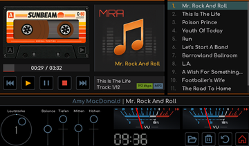
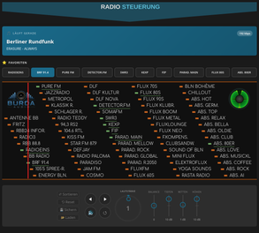
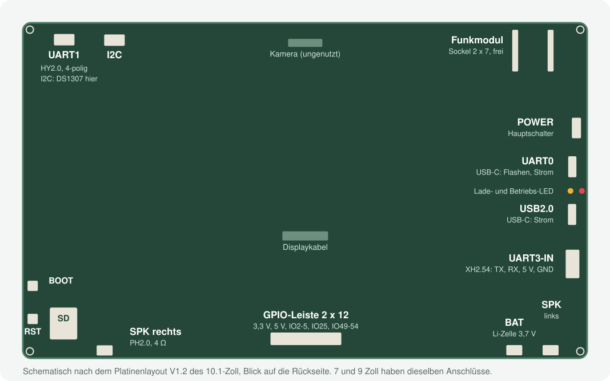

# RetroRadioCrowPanel

[Dokumentation](#dokumentation) | [Erstinstallation](docs/RetroRadioCrowPanel-Ersteinrichtung.md) | [Bedienung](docs/Bedienung.md) | [Radio und Musik](docs/Radio-und-Musik.md) | [Geräte und Anschlüsse](docs/Geräte-und-Anschlüsse.md)

Ein Internetradio mit dem Aussehen eines klassischen Tischradios für die **Elecrow CrowPanel Advanced ESP32-P4**. Analogskala, magisches Auge, acht Visualisierungen und Musik von der SD-Karte laufen auf dem Touchdisplay mit 1024 x 600 Pixeln.

**Eine Firmware für die ganze Familie:** RetroRadioCrowPanel läuft ohne Änderung auf dem CrowPanel Advanced mit **7 Zoll, 9 Zoll und 10,1 Zoll**. Alle drei haben dieselbe Platine, dieselbe Auflösung und dieselben Anschlüsse, nur Bildschirm und Gehäuse sind verschieden groß. Ein Quellstand, ein Build, ein Satz Bilder in dieser Dokumentation.

> **Deutsch oder Englisch:** Gerät und Weboberfläche sprechen Deutsch oder Englisch, umgestellt wird unter Einstellungen -> Allgemein -> Sprache. Die Anleitungen sind deutsch.
>
> *The user interface on the device and in the browser can be switched to English: Einstellungen -> Allgemein -> Sprache -> English. The documentation is written in German.*

Das Foto zeigt von links nach rechts das 10,1-, das 9- und das 7-Zoll-Modell mit derselben Firmware, jedes mit einer kleinen Uhr DS1307 am Stecker I2C.

RetroRadioCrowPanel ist eine Portierung von [RetroRadio](https://github.com/DIYLAB-DE/RetroRadio). Radio, SD-Player, Hauptmenü, Einstellungen und Weboberfläche stammen aus dem Original, Zeichenwege, Schriften, Bilder und Bedienung wurden übernommen und werden ohne Skalierung in der vollen Auflösung des CrowPanel gezeichnet. Das CrowPanel bringt Gehäuse, Display, Verstärker, Lautsprecheranschlüsse, SD-Kartenleser und einen Akkuanschluss schon mit, Lötarbeiten sind nicht nötig. Eine kleine Uhr DS1307 am I2C-Stecker ist optional.

## Dokumentation

| Thema | Anleitung |
| --- | --- |
| Installieren | [Fertige Firmware im Browser aufspielen (Web-Flasher)](https://diylab-de.github.io/RetroRadioCrowPanel/), oder selbst bauen: [Windows, Linux und macOS mit VS Code/PlatformIO](docs/RetroRadioCrowPanel-Ersteinrichtung.md), [PDF herunterladen](docs/RetroRadioCrowPanel-Ersteinrichtung.pdf) |
| Benutzen | [Gerätebedienung](docs/Bedienung.md), [Radio und SD-Player](docs/Radio-und-Musik.md), [Weboberfläche und FTP](docs/Weboberfläche.md) |
| Hardware | [Die drei Displays, Anschlüsse der Rückseite, Akku, Lautsprecher und Uhr](docs/Geräte-und-Anschlüsse.md) |
| Fehler finden | [Fehlerhilfe](docs/Fehlerhilfe.md) |
| Versionen und Herkunft | [Änderungen](docs/Änderungen.md), [Lizenzen und Herkunft](docs/LIZENZEN.md) |

Die Anleitungen und Kommentare sind deutsch. Kleine Vorschaubilder öffnen die vollständigen Abbildungen. Die Dokumentation liegt direkt im Repository und ist mit dem jeweiligen Quellstand verfügbar.

## Die drei Displays im Vergleich

Herstellerangaben von Elecrow, Stand 14.11.2026. Die letzte Zeile nennt, was mit RetroRadioCrowPanel tatsächlich geprüft ist.

| | CrowPanel Advanced 7" | CrowPanel Advanced 9" | CrowPanel Advanced 10.1" |
| --- | --- | --- | --- |
| Modell | DHE04107D | DHE04209D | DHE04310D |
| Bildschirm | 7 Zoll IPS, 1024 x 600 | 9 Zoll IPS, 1024 x 600 | 10,1 Zoll IPS, 1024 x 600 |
| Pixeldichte (gerechnet) | rund 170 ppi | rund 132 ppi | rund 118 ppi |
| Abmessungen | 180 x 105 mm | 222 x 130 x 16 mm | 248 x 147 mm |
| Gewicht | 450 g | 700 g | 960 g |
| Helligkeit, Blickwinkel | 400 cd/m², 178° | 400 cd/m², 178° | 400 cd/m², 178° |
| Touch | kapazitiv, 5 Punkte | kapazitiv, 5 Punkte | kapazitiv, 5 Punkte |
| Prozessor und Speicher | ESP32-P4, 32 MB PSRAM, 16 MB Flash | gleich | gleich |
| WLAN | ESP32-C6, Wi-Fi 6, 2,4 GHz | gleich | gleich |
| Ton | zwei Verstärker, zwei Lautsprecheranschlüsse | gleich | gleich |
| Hersteller | [Shop](https://www.elecrow.com/crowpanel-advanced-7inch-esp32-p4-hmi-ai-display-1024x600-ips-touch-screen-with-wifi-6-compatible-with-arduino-lvgl-micropython.html), [Wiki](https://www.elecrow.com/wiki/CrowPanel_Advanced_7inch_ESP32-P4_HMI_AI_Display_1024x600_IPS_Touch_Screen_with_WiFi6_Compatible_with_ArduinoLVGL.html), [GitHub](https://github.com/Elecrow-RD/CrowPanel-Advanced-7inch-ESP32-P4-HMI-AI-Display-1024x600-IPS-Touch-Screen) | [Shop](https://www.elecrow.com/crowpanel-advanced-9inch-esp32-p4-hmi-ai-display-1024x600-ips-touch-screen-wifi-6-support.html), [Wiki](https://www.elecrow.com/wiki/CrowPanel_Advanced_9inch_ESP32-P4_HMI_AI_Display_1024x600_IPS.html), [GitHub](https://github.com/Elecrow-RD/CrowPanel-Advanced-9inch-ESP32-P4-HMI-AI-Display-1024x600-IPS-Touch-Screen) | [Shop](https://www.elecrow.com/crowpanel-advanced-10-1inch-esp32-p4-hmi-ai-display-1024x600-ips-touch-screen-wifi-6.html), [Wiki](https://www.elecrow.com/wiki/CrowPanel_Advanced_10.1inch_ESP32-P4_HMI_AI_Display_1024x600_IPS.html), [GitHub](https://github.com/Elecrow-RD/CrowPanel-Advanced-10.1inch-ESP32-P4-HMI-AI-Display-1024x600-IPS-Touch-Screen) |
| Mit RetroRadioCrowPanel geprüft | Platine V1.2, ESP32-P4 Revision 1.3 | Platine V1.2, ESP32-P4 Revision 1.3 | Platine V1.2, ESP32-P4 Revision 1.3 |

Weil alle drei 1024 x 600 Pixel haben, sieht die Oberfläche auf jedem Gerät gleich aus, nur verschieden groß. Das 7-Zoll zeigt sie am feinsten, ungefähr so groß wie das Original-RetroRadio mit seinem 7-Zoll-Display. Die Bilder dieser Dokumentation stammen vom 10.1-Zoll und gelten für alle drei.

## Radio und Musik

Das Internetradio zeigt 70 Senderplätze auf einer nachgebildeten Analogskala mit beweglichem Zeiger. Favoriten erleichtern die Auswahl der Lieblingssender. Vier magische Augen und acht Visualisierungen begleiten die Wiedergabe, das magische Auge zeigt im Stand die Stärke des WLAN-Empfangs. Lautstärke, Balance und Klang stellst Du direkt am Drehknopf und an den Schiebereglern ein.

Der SD-Player spielt Musik von der eingelegten microSD-Karte. Ordnerauswahl, Playlist mit Titel- und Listenwiederholung, Coveranzeige und acht animierte Kassetten gehören zur Bedienoberfläche.

Über die Weboberfläche im lokalen Netzwerk bedienst Du das Radio, pflegst und sortierst die Sender, verwaltest die Dateien auf der SD-Karte und wählst Thema und Farben. Zur Dateiübertragung steht auch FTP zur Verfügung.

| Radio | SD-Player | Weboberfläche |
| --- | --- | --- |
|  |  |  |

## Was RetroRadioCrowPanel kann

| Anwendung | Wofür Du sie nutzen kannst |
| --- | --- |
| Hauptmenü | Große Uhr mit Datum, WLAN-Anzeige und den drei Symbolen für Radio, SD-Player und Einstellungen. |
| Radio | Internetradio mit Analogskala, Favoriten, magischem Auge, Visualisierungen und Sleep-Timer. |
| SD-Player | Musik von der microSD-Karte mit Kassettenansicht, Cover, Playlist und Wiederholung. |
| Einstellungen | WLAN, Zeit, Zeitfenster, Sprache, PIN-Sperre, Klang, Anzeige, Thema, Bildschirm und Geräteinformationen. |
| Weboberfläche | Fernbedienung, Senderpflege, Systemeinstellungen, Farben, Dateimanager mit FTP und Bildschirmaufnahme im Browser. |

Drei Themen stehen zur Wahl: **Retro** mit den Farben des Originals, **E-Paper** in hellen Papiertönen und **Individuell** mit eigenen Farben aus der Weboberfläche. Das Bild lässt sich um 180° drehen, je nachdem, auf welcher Seite die Kabel stecken. Für das Internetradio wird eine WLAN-Verbindung benötigt.

## Hardware

Gebraucht wird ein **CrowPanel Advanced ESP32-P4** mit 7, 9 oder 10,1 Zoll, dazu ein USB-C-Datenkabel und ein USB-Netzteil mit 5 V und 2 A. Alles Weitere ist an Bord. Der Platinenstand V2.0 (Aufdruck auf der Platine) hat einen anderen Tonweg und wird noch nicht unterstützt, siehe [Beschaffung](#beschaffung).

- **Anschlüsse auf der Rückseite:** zwei USB-C-Buchsen (**UART0** zum Übertragen der Firmware, **USB2.0** zur Versorgung), ein 5-V-Eingang mit seriellem Anschluss (**UART3-IN**), zwei Grove-kompatible Stecker (**UART1** und **I2C**), eine Stiftleiste mit 24 Kontakten, ein Sockel für ein Funkmodul, der microSD-Kartenleser und die Tasten **BOOT** und **RST**. Was wohin gehört, steht unter [Geräte und Anschlüsse](docs/Geräte-und-Anschlüsse.md#die-rückseite).
- **Ton an Bord:** Zwei digitale Verstärker (NS4168) treiben zwei Lautsprecheranschlüsse **SPK** für links und rechts, das Radio spielt in Stereo. Elecrow nennt Kammerlautsprecher mit 4 Ω und 3 W. Wer mehr Klang möchte, ersetzt die kleinen Lautsprecher durch größere Typen mit Steckern PH2.0, siehe [Lautsprecher](docs/Geräte-und-Anschlüsse.md#lautsprecher).
- **Akku:** Eine Lithium-Zelle mit 3,7 V passt an den Stecker **BAT**, die Ladeschaltung ist eingebaut. Mit RetroRadioCrowPanel ist der Akkubetrieb noch nicht geprüft, eine Ladeanzeige gibt es nicht, siehe [Akku](docs/Geräte-und-Anschlüsse.md#akku).
- **Uhr:** Das CrowPanel hat keine Uhr mit Pufferbatterie. Ohne Zusatz kommt die Uhrzeit nach dem Start aus dem Netz. Eine **DS1307** am Stecker **I2C** hält die Zeit auch ohne Strom und merkt sich Sender, Lautstärke und Klang wie im Original-RetroRadio, siehe [Uhr DS1307](docs/Geräte-und-Anschlüsse.md#uhr-ds1307).
- **Versorgung:** Mit Bild braucht das CrowPanel laut Hersteller 8 bis 10 W. Der USB-Anschluss eines Rechners allein kann zu schwach sein, dann bleibt das Bild schwarz. Sehr zu empfehlen ist ein USB-C-Netzteil mit 20 W, siehe [Beschaffung](#beschaffung).

Kamera, Mikrofon und Funkmodulsockel nutzt RetroRadioCrowPanel nicht. **UART1** und die Kontakte IO49 bis IO51 der Stiftleiste sind vorläufig für den späteren Bluetooth-Sender vorgesehen. Die Firmware schaltet sie als Eingänge und sendet dort nichts, solange kein Sender antwortet. Belege sie deshalb vorerst nicht mit eigenen Schaltungen.

### Beschaffung

Preise vom 14.11.2026, sie schwanken. Bei Amazon gab es das 10-Zoll zeitweise im Angebot für rund 80 EUR, es lohnt sich, auf Angebote zu achten.

| Was | Bezugsquelle | Preis |
| --- | --- | --- |
| CrowPanel Advanced 10.1" | [Amazon](https://www.amazon.de/dp/B0GCJVLP7B) | 96,99 EUR |
| CrowPanel Advanced 9" | [BerryBase](https://www.berrybase.de/elecrow-crowpanel-advance-9.0-hmi-touch-display-esp32-p4-c6-wi-fi-6-bt-5.3-flash-psram-gpio-5v) | 59,90 EUR |
| CrowPanel Advanced 7" | [Amazon](https://www.amazon.de/dp/B0G34ZXVZ6), Ausführung ohne Kamera | 77,99 EUR |
| USB-C-Netzteil | [Anker 20 W USB-C mit Power Delivery, Doppelpack mit USB-C-Kabel](https://www.amazon.de/dp/B0DWK7K4C2), in Schwarz, Weiß und Lila | 14,41 EUR |
| Uhr DS1307 (optional) | Tiny-RTC-Platine HW-111, bei vielen Händlern | rund 1 EUR |

Direkt bei Elecrow gibt es alle drei Größen ebenfalls, die Links stehen im [Vergleich](#die-drei-displays-im-vergleich).

**Das Netzteil ist sehr zu empfehlen:** günstig, kräftig und von einem Markenhersteller. Daran laufen alle drei Displays mit 5 V einwandfrei. Im Doppelpack reicht es für zwei Geräte.

Händler nennen meist weder den Platinenstand noch die Chiprevision des ESP32-P4. Geprüft ist RetroRadioCrowPanel mit Platinenstand V1.2 und Revision 1.3. V1.3 hat laut Hersteller dieselbe Schaltung mit einem zusätzlichen Aufdruck. Seit November 2026 führt der Hersteller den Platinenstand V2.0 mit einem ESP32-P4 Revision 3.2 und einem Codec ES8311 statt der beiden Verstärker. Dafür ist die Firmware noch nicht gemacht. Web-Flasher und Upload erkennen solche Geräte am Chip und schreiben nichts auf sie.

### Ausblick

Die Seiten **Bluetooth** und **UKW** in den Einstellungen sind schon vorhanden. Geplant ist, über den Funkmodulsockel oder die herausgeführten Anschlüsse einen kleinen **Bluetooth-Sender** mit einem ESP32-Pico-D4 anzuschließen, für Bluetooth-Kopfhörer und -Lautsprecher. Dazu können ein **UKW-Modulator mit RDS** für Radios im Haus und ein **optischer Ausgang (TOSLINK)** kommen. Bis dahin bleiben beide Seiten ohne Funktion.

## Nachbau und Inbetriebnahme

Das Projekt lässt sich in Visual Studio Code mit PlatformIO öffnen, bearbeiten, bauen und auf das CrowPanel übertragen. Ein USB-C-Datenkabel an der Buchse **UART0** genügt zum Übertragen. Es gibt zwei Projektumgebungen: `crowpanel_p4es` für alle bisher bekannten Geräte und `crowpanel_p4v3` für spätere Geräte mit ESP32-P4 ab Revision 3.0. Der Upload liest die Revision vor dem Schreiben aus und bricht ab, wenn sie nicht zur gewählten Umgebung passt.

Die [Anleitung zur ersten Inbetriebnahme](docs/RetroRadioCrowPanel-Ersteinrichtung.md) führt durch die Installation unter Windows, Linux und macOS. Updates schreiben nur die Firmware und lassen Einstellungen, Sender und WLAN-Zugangsdaten unberührt. Zugangsdaten stehen nie im Quellcode: WLAN, PIN und alles Weitere richtest Du nach dem ersten Start am Gerät ein.

Die Versionsnummer steht in der Firmware fest und ändert sich nur mit einem Release. Ein eigener Build aus demselben Quellstand zeigt dieselbe Nummer. Was sich zwischen den Versionen geändert hat, steht unter [Änderungen](docs/Änderungen.md).

## Lizenz und Herkunft

Der RetroRadioCrowPanel-Quellcode steht wie RetroRadio unter der [GPL-3.0](LICENSE). Enthaltene Bibliotheken, Schriften, Symbole und Bilder haben eigene Herkunfts- und Lizenzvermerke, die Übersicht steht in [LIZENZEN.md](docs/LIZENZEN.md).

Danke an Wolle alias schreibfaul1 für ESP32-audioI2S als Grundlage der Audio-Bibliothek `audio-lite`, an N. Waldt für den EM34-Emulator, an dem sich die Optik der Abstimmröhren orientiert, an lovyan03 für LovyanGFX, auf dem die Zeichenwege beruhen, an Espressif für den Displaytreiber EK79007 und an das Projekt Phosphor Icons für die verwendeten Symbole. Danke an Elecrow für die offenen Schaltpläne und Unterlagen der CrowPanel-Reihe.

[Dokumentation](#dokumentation) | [Erstinstallation](docs/RetroRadioCrowPanel-Ersteinrichtung.md) | [Bedienung](docs/Bedienung.md) | [Radio und Musik](docs/Radio-und-Musik.md) | [Geräte und Anschlüsse](docs/Geräte-und-Anschlüsse.md)
