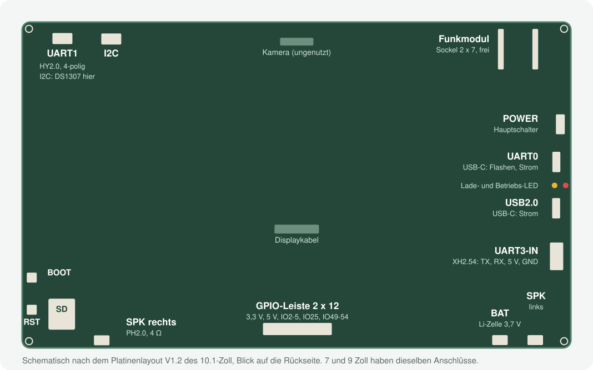
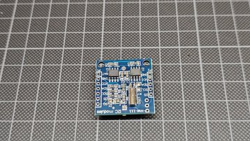
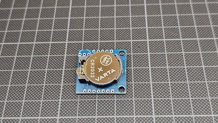

# Geräte und Anschlüsse

[RetroRadioCrowPanel](../README.md) > [Dokumentation](../README.md#dokumentation) > Geräte und Anschlüsse

RetroRadioCrowPanel läuft auf dem **Elecrow CrowPanel Advanced ESP32-P4** mit 7, 9 und 10,1 Zoll. Die drei Modelle teilen Schaltung, Auflösung und Anschlüsse, deshalb gibt es nur eine Firmware und einen Satz Bilder. Diese Seite beschreibt, was auf der Rückseite steckt und wofür RetroRadioCrowPanel es nutzt. Herstellerangaben stammen aus Wiki, Shop und Schaltplänen von Elecrow, Stand 14.11.2026. Was am Gerät geprüft ist, steht ausdrücklich dabei.

## Die drei Modelle

| | 7 Zoll | 9 Zoll | 10,1 Zoll |
| --- | --- | --- | --- |
| Modell | DHE04107D | DHE04209D | DHE04310D |
| Bildschirm | IPS, 1024 x 600, rund 170 ppi | IPS, 1024 x 600, rund 132 ppi | IPS, 1024 x 600, rund 118 ppi |
| Abmessungen laut Hersteller | 180 x 105 mm, aktive Fläche 155 x 87 mm | 222 x 130 x 16 mm | 248 x 147 mm |
| Gewicht laut Hersteller | 450 g | 700 g | 960 g |
| Preis bei Elecrow (14.11.2026) | ab 48,90 USD | ab 50,90 USD | ab 53,90 USD |
| Wiki und Schaltpläne | [Wiki](https://www.elecrow.com/wiki/CrowPanel_Advanced_7inch_ESP32-P4_HMI_AI_Display_1024x600_IPS_Touch_Screen_with_WiFi6_Compatible_with_ArduinoLVGL.html), [GitHub](https://github.com/Elecrow-RD/CrowPanel-Advanced-7inch-ESP32-P4-HMI-AI-Display-1024x600-IPS-Touch-Screen) | [Wiki](https://www.elecrow.com/wiki/CrowPanel_Advanced_9inch_ESP32-P4_HMI_AI_Display_1024x600_IPS.html), [GitHub](https://github.com/Elecrow-RD/CrowPanel-Advanced-9inch-ESP32-P4-HMI-AI-Display-1024x600-IPS-Touch-Screen) | [Wiki](https://www.elecrow.com/wiki/CrowPanel_Advanced_10.1inch_ESP32-P4_HMI_AI_Display_1024x600_IPS.html), [GitHub](https://github.com/Elecrow-RD/CrowPanel-Advanced-10.1inch-ESP32-P4-HMI-AI-Display-1024x600-IPS-Touch-Screen) |

Gemeinsam haben alle drei: ESP32-P4 mit 32 MB PSRAM und 16 MB Flash, WLAN über einen ESP32-C6 (Wi-Fi 6, 2,4 GHz), Displaytreiber EK79007, kapazitiver Touch mit fünf Punkten (GT911), 400 cd/m² und 178° Blickwinkel, zwei digitale Verstärker, microSD-Kartenleser und Ladeschaltung für einen Akku. Das Gehäuse hat ringsum Befestigungslöcher für M3.

**Geprüft mit RetroRadioCrowPanel:** je ein Gerät jeder Größe mit Platinenstand V1.2 und ESP32-P4 Revision 1.3. Bild, Touch, Drehung, WLAN, Radio mit Ton, Uhr mit DS1307 und SD-Player laufen auf allen drei. Den Platinenstand trägt die Platine als Aufdruck. Ältere Stände (V1.0, V1.1) sind nicht geprüft.

## Die Rückseite

Die Skizze zeigt die Platine des 10.1-Zoll von hinten, schematisch nach dem Platinenlayout V1.2 von Elecrow. Die Namen sind die Aufdrucke auf dem Gerät. 7 und 9 Zoll haben dieselben Anschlüsse mit denselben Namen, auf der kleineren Platine können sie anders verteilt sein.

| Aufdruck | Bauform | Belegung laut Schaltplan | In RetroRadioCrowPanel |
| --- | --- | --- | --- |
| **POWER** | Schiebeschalter | Hauptschalter für alles außer der Ladeschaltung | Ein- und Ausschalten |
| **UART0** | USB-C | Seriell über einen CH340K zum ESP32-P4, mit automatischem Wechsel in den Download-Modus | Firmware übertragen, Versorgung |
| **USB2.0** | USB-C | USB direkt am ESP32-P4 | Nur Versorgung |
| **UART3-IN** | XH2.54, 4-polig | 1 TX, 2 RX (5-V-Pegel), 3 +5 V Eingang, 4 GND | Wahlweise 5-V-Versorgung, die seriellen Leitungen sind ungenutzt |
| **UART1** | HY2.0, 4-polig | 1 RX, 2 TX (aus Sicht des CrowPanel), 3 3,3 V, 4 GND | Vorläufig für den späteren Bluetooth-Sender vorgesehen |
| **I2C** | HY2.0, 4-polig | 1 SCL, 2 SDA, 3 3,3 V, 4 GND, gemeinsam mit dem Touch | Optionale [Uhr DS1307](#uhr-ds1307) |
| **SPK** (zweimal) | PH2.0, 2-polig | je ein Verstärker NS4168, Aufdruck links (neben **BAT**) und rechts (neben der SD-Karte) | [Lautsprecher](#lautsprecher), Stereo |
| **BAT** | PH2.0, 2-polig | 1 Plus, 2 Minus einer Lithium-Zelle | [Akku](#akku), nicht geprüft |
| Stiftleiste | 2 x 12 Kontakte | 3,3 V, 5 V, GND, IO2 bis IO5, IO25, IO49 bis IO54 | IO49 bis IO51 vorläufig für den Bluetooth-Sender, sonst frei |
| Funkmodulsockel | zwei Buchsenleisten 2 x 7, Raster 2,54 mm | SPI, eine serielle Schnittstelle, I2C, 3,3 V | Frei, gedacht für den späteren Bluetooth-Sender |
| microSD | Kartenhalter | 1-Bit-SD | SD-Player, Dateimanager, FTP |
| **BOOT**, **RST** | Taster | Download-Modus beim Einschalten, Neustart | Nur bei Problemen nötig, siehe [Erstinstallation](RetroRadioCrowPanel-Ersteinrichtung.md#11-hilfe-bei-problemen) |
| Zwei LEDs | | Betrieb und Laden | Leuchten von selbst |

Kamera und Mikrofon sind auf der Platine vorgesehen, RetroRadioCrowPanel nutzt sie nicht. Die Firmware des WLAN-Chips ESP32-C6 bleibt unverändert, so wie sie ab Werk aufgespielt ist.

## Versorgung

Laut Hersteller braucht das CrowPanel 5 V und bis zu 2 A, mit Bild 8 bis 10 W. Der USB-Anschluss eines Rechners allein kann dafür zu schwach sein, dann bleibt das Bild schwarz oder das Gerät startet neu. So geht es sicher:

- **Zum Übertragen der Firmware** steckt das Datenkabel vom Rechner an **UART0**.
- **Im Betrieb** versorgt ein USB-Netzteil mit 5 V und mindestens 2 A das Gerät an **USB2.0** oder **UART0**. Wahlweise kommen 5 V an **UART3-IN**.

Sehr zu empfehlen ist das [Anker 20 W USB-C-Netzteil mit Power Delivery](https://www.amazon.de/dp/B0DWK7K4C2) im Doppelpack mit USB-C-Kabel: günstig, kräftig und von einem Markenhersteller. Daran laufen alle drei Displays mit 5 V einwandfrei. Weitere Bezugsquellen stehen unter [Beschaffung](../README.md#beschaffung).

Die drei Eingänge sind auf der Platine über Dioden getrennt, Datenkabel und Netzteil dürfen gleichzeitig stecken. **POWER** schaltet das Gerät ein und aus.

## Lautsprecher

Auf der Platine sitzen zwei digitale Verstärker NS4168, einer je Kanal. Sie treiben die beiden Stecker **SPK** (PH2.0, 2-polig), RetroRadioCrowPanel spielt darüber in Stereo. Elecrow nennt Kammerlautsprecher YZ3020 mit 4 Ω und 3 W.

Maßgeblich ist die Aufschrift an den Buchsen: Der linke Kanal kommt an der Buchse mit der Aufschrift links an, sie sitzt neben dem Akkustecker **BAT**. Die Buchse für rechts sitzt neben der SD-Karte. Stecke den Lautsprecher, der von vorn gesehen links steht, an die Buchse links. Die Zuordnung bleibt gleich, wenn Du das Bild um 180° drehst. Geprüft ist das an allen drei Größen.

Die mitgelieferten Lautsprecher sind klein. Wer mehr Klang möchte, schließt größere Lautsprecher an:

- Impedanz 4 bis 8 Ω, belastbar mit mindestens 3 W.
- Stecker PH2.0, 2-polig, wie am mitgelieferten Lautsprecher. Ein Adapterkabel mit diesem Stecker genügt, gelötet wird an der Platine nichts.
- Die beiden Anschlüsse eines Kanals nie miteinander, mit GND oder mit dem anderen Kanal verbinden. Die Verstärker treiben beide Leitungen gegeneinander.
- Im Akkubetrieb liegen statt 5 V nur rund 4 V an den Verstärkern, sie spielen dann etwas leiser.

Die **Balance** im Radio und im SD-Player verschiebt den Klang zwischen den beiden Lautsprechern, ganz außen ist die andere Seite 16 dB leiser. Die **Basisbreite** unter Einstellungen -> Klang macht das Stereobild breiter oder schmaler.

Unter Einstellungen -> Klang schaltet **Lautsprecher** **Aus** den Ton ganz ab. Beim Start bleiben die Verstärker aus, bis die Wiedergabe wirklich beginnt, das vermeidet Knacken.

## Akku

An den Stecker **BAT** (PH2.0, 2-polig) passt laut Hersteller eine Lithium-Zelle mit 3,7 V (geladen 4,2 V). Die Ladeschaltung (TP4059) ist an Bord und lädt mit höchstens 430 mA, sobald 5 V an einem der Eingänge anliegen. Die LED **CHG** zeigt das Laden an.

- **Polung prüfen:** Akkus mit Stecker PH2.0 gibt es mit beiden Polungen. Laut Schaltplan liegt Plus an Kontakt 1 des Steckers **BAT**. Prüfe die Polung des Akkusteckers vor dem Anstecken mit einem Messgerät.
- **Laufzeit abschätzen:** Mit Bild braucht das CrowPanel laut Hersteller 8 bis 10 W bei voller Helligkeit. Eine Zelle mit 2000 mAh (rund 7,4 Wh) reicht damit rechnerisch kaum eine Stunde. Weniger Helligkeit verlängert die Laufzeit. Gemessen ist das nicht.
- **Stand in RetroRadioCrowPanel:** Der Akkubetrieb ist mit RetroRadioCrowPanel nicht geprüft. Die Firmware zeigt keinen Ladestand, der Hilfscontroller auf der Platine, der die Akkuspannung misst, hat keine veröffentlichte Firmware.

## Uhr DS1307

Das CrowPanel hat keine Uhr mit eigener Batterie. Ohne Zusatz kennt RetroRadioCrowPanel die Uhrzeit erst, wenn das WLAN steht und der Zeitserver geantwortet hat. Sender, Lautstärke und Klang landen dann im Flash, geschrieben erst nach fünf Sekunden ohne weitere Änderung, damit der Flash geschont wird.

Eine kleine Uhrenplatine mit **DS1307** am Stecker **I2C** ändert das: Die Uhrzeit steht sofort nach dem Einschalten bereit, auch ohne WLAN, und Sender, Lautstärke, Balance, Klang, Stummschaltung und die Wahl der Visualisierungen liegen im Speicher der DS1307 und werden bei jeder Änderung sofort geschrieben, genau wie im Original-RetroRadio. Nach jedem Abgleich mit dem Zeitserver stellt RetroRadioCrowPanel die DS1307 nach. Die Firmware sucht die Uhr bei jedem Start selbst, eine Einstellung gibt es nicht.

### Uhrenplatine vorbereiten

Verwendet wird die verbreitete Tiny-RTC-Platine mit DS1307, Aufdruck HW-111, für rund 1 EUR zu haben. Wie beim Original-RetroRadio wird sie vor dem Einsatz kurz umgebaut:

1. **Diode D1 unbedingt entfernen.** Sie gehört zu einer Ladeschaltung für einen Akku LIR2032. Mit der üblichen Knopfzelle CR2032, die sich nicht laden lässt, darf dieser Ladepfad nicht bestückt bleiben.
2. **EEPROM U3 bei Bedarf entfernen.** RetroRadioCrowPanel nutzt ihn nicht.
3. **Grove-Buchse anlöten:** eine 4-polige Buchse HY2.0 (Grove) an die Anschlüsse **SCL**, **SDA**, **VCC** und **GND** der Platine, in dieser Reihenfolge.
4. **Kurzes Grove-Kabel** zwischen Uhr und dem Stecker **I2C** des CrowPanel. Das Kabel wird **nicht** gedreht: Kontakt 1 geht auf Kontakt 1, Kontakt 2 auf Kontakt 2 und so weiter.
5. Eine **CR2032** einsetzen, sie hält die Uhr, wenn das CrowPanel aus ist.

| Bestückungsseite, D1 entfernt, U3 noch bestückt | Batterieseite mit CR2032 |
| --- | --- |
|  |  |

### Verbindung

| I2C am CrowPanel (HY2.0) | Signal | DS1307-Platine | Übliche Farbe am Grove-Kabel |
| --- | --- | --- | --- |
| 1 | SCL | SCL | gelb |
| 2 | SDA | SDA | weiß |
| 3 | 3,3 V | VCC | rot |
| 4 | GND | GND | schwarz |

Die Farben sind bei Kabeln verschiedener Hersteller nicht immer gleich, maßgeblich ist die Reihenfolge der Kontakte am Stecker. Geprüft ist das an allen drei CrowPanel mit der so vorbereiteten Platine HW-111 und einem ungedrehten Grove-Kabel, das Foto in der [README](../README.md) zeigt den Aufbau. Laut [Datenblatt](https://www.analog.com/media/en/technical-documentation/data-sheets/DS1307.pdf) ist die DS1307 für 4,5 bis 5,5 V gebaut, der Betrieb mit 3,3 V liegt außerhalb dieser Angabe. An allen drei CrowPanel und am Original-RetroRadio läuft sie damit. Der I2C-Bus läuft mit 100 kHz wie im Original.

Eine DS1307 aus einem RetroRadio lässt sich weiterverwenden: RetroRadioCrowPanel nutzt dieselbe Belegung ihres Speichers, übernimmt beim Start Sender und Lautstärke und schreibt danach seine eigenen Werte hinein.

## Später

Für den Funkmodulsockel ist ein kleiner **Bluetooth-Sender** mit einem ESP32-Pico-D4 geplant, für Bluetooth-Kopfhörer und -Lautsprecher, dazu ein **UKW-Modulator mit RDS** und ein **optischer Ausgang (TOSLINK)**. Die Seiten **Bluetooth** und **UKW** in den Einstellungen sind dafür schon vorhanden und bleiben bis dahin ohne Funktion.

[Erstinstallation](RetroRadioCrowPanel-Ersteinrichtung.md) | [Bedienung](Bedienung.md) | [Fehlerhilfe](Fehlerhilfe.md)

[RetroRadioCrowPanel](../README.md) > [Dokumentation](../README.md#dokumentation) > Geräte und Anschlüsse
