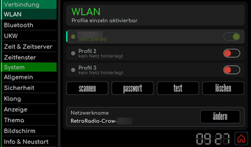
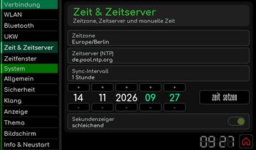

# RetroRadioCrowPanel: Erste Inbetriebnahme

[RetroRadioCrowPanel](../README.md) > [Dokumentation](../README.md#dokumentation) > RetroRadioCrowPanel: Erste Inbetriebnahme

Diese Anleitung führt Dich vom fabrikneuen CrowPanel Advanced ESP32-P4 zum gestarteten RetroRadioCrowPanel. Sie gilt gleichermaßen für das 7-, das 9- und das 10.1-Zoll-Modell. Du bereitest das Projekt unter Windows, Linux oder macOS in Visual Studio Code mit PlatformIO vor und überträgst die Firmware über ein USB-C-Kabel. Danach kannst Du denselben Projektordner zum Lesen und Bearbeiten des Quellcodes und für spätere Aktualisierungen verwenden.

**Stand: 26.11.2026.** Der Ablauf wurde unter Linux praktisch bestätigt: Je ein CrowPanel mit 7, 9 und 10,1 Zoll, alle mit Werksfirmware, wurde damit eingerichtet und danach mehrfach aktualisiert. Unter Windows ist der Upload vorbereitet, aber noch nicht an einem Gerät durchgelaufen. Die Schritte für macOS stützen sich auf die offiziellen Software- und Treiberunterlagen, ein eigener Durchlauf steht dort ebenfalls aus. Der Web-Flasher wurde unter Linux in Chrome an zwei Geräten mit 10,1 Zoll geprüft, als Erstinstallation ab Werksfirmware und als Update. Rückmeldungen dazu helfen.

> Die ab Werk installierte Demo von Elecrow wird durch RetroRadioCrowPanel ersetzt, eine Zwischen-Firmware ist nicht erforderlich. Die Werksfirmware gibt es im Repository des Herstellers, siehe [Rückweg zur Werksfirmware](#rückweg-zur-werksfirmware).

## Schnellweg: der Web-Flasher

Wer nur die fertige Firmware aufspielen möchte, braucht weder Visual Studio Code noch PlatformIO. Der [Web-Flasher](https://diylab-de.github.io/RetroRadioCrowPanel/) überträgt das neueste Release direkt aus dem Browser, zur Erstinstallation und für spätere Updates.

1. Die Seite in **Chrome, Edge oder Opera** auf einem Rechner öffnen. Firefox, Safari, Smartphones und Tablets können nicht auf serielle Anschlüsse zugreifen.
2. Das Datenkabel in die Buchse **UART0** stecken und den Schalter **POWER** einschalten.
3. **Verbinden** wählen und im Fenster des Browsers den Anschluss auswählen. Er heißt meist „USB Serial“ oder trägt „CH340“ im Namen.
4. Die Seite zeigt Chip, Revision und MAC-Adresse des gefundenen Geräts. **Installieren** überträgt die Firmware und prüft sie, das dauert rund eine Minute. Danach startet das CrowPanel neu.

Die Seite arbeitet wie der [geprüfte Upload](#6-der-geprüfte-upload): Sie schreibt nur Bootloader, Partitionstabelle und Firmware und vergleicht alles nach dem Schreiben. Einstellungen, PIN, WLAN-Zugangsdaten und Sender bleiben erhalten, die Firmware des WLAN-Chips wird nicht verändert. Erscheint in der Auswahl kein Anschluss, hilft [Kein passender serieller Anschluss erscheint](#kein-passender-serieller-anschluss-erscheint). Weiter geht es mit [Erster Start und Grundeinstellungen](#9-erster-start-und-grundeinstellungen).

Die Abschnitte 1 bis 8 brauchst Du nur, wenn Du die Firmware selbst bauen oder den Quellcode ändern möchtest.

## 1. Was Du brauchst

- Ein **CrowPanel Advanced ESP32-P4** mit 7, 9 oder 10,1 Zoll. Geprüft ist der Platinenstand V1.2, siehe [Geräte und Anschlüsse](Geräte-und-Anschlüsse.md). V1.3 hat laut Hersteller dieselbe Schaltung. Der Platinenstand V2.0 wird noch nicht unterstützt.
- Ein USB-C-Datenkabel, passend zu Deinem Rechner. Ein reines Ladekabel reicht nicht.
- Für den Betrieb ohne Rechner ein USB-Netzteil mit 5 V und mindestens 2 A, sehr zu empfehlen ist ein [Anker 20 W USB-C-Netzteil](https://www.amazon.de/dp/B0DWK7K4C2). Am USB-Anschluss eines Rechners läuft das CrowPanel meist auch. Ist er zu schwach, bleibt das Bild schwarz oder das Gerät startet von selbst neu.
- Einen Rechner mit Windows, Linux oder macOS und Internetzugang für den Download der Entwicklungswerkzeuge und Projektabhängigkeiten.
- Visual Studio Code mit der Erweiterung PlatformIO IDE sowie den vollständigen RetroRadioCrowPanel-Projektordner.
- Ein WLAN im 2,4-GHz-Band für das Internetradio.
- Für den SD-Player eine microSD-Karte mit FAT32. Die Firmware kann kein exFAT lesen, Karten ab 64 GB sind ab Werk meist mit exFAT formatiert.
- Optional eine [Uhr DS1307](Geräte-und-Anschlüsse.md#uhr-ds1307) für den Stecker **I2C**, vorbereitet wie unter [Uhrenplatine vorbereiten](Geräte-und-Anschlüsse.md#uhrenplatine-vorbereiten) beschrieben.

## 2. Visual Studio Code und PlatformIO einrichten

### Vorbereitung für Dein Betriebssystem

Installiere die Desktop-Ausgabe von [Visual Studio Code](https://code.visualstudio.com/download). Die folgenden Schritte werden in der lokal installierten Anwendung ausgeführt.

| Betriebssystem | Vorbereitung |
| --- | --- |
| Windows | Verwende das zu Deinem Rechner passende [VS-Code-Installationsprogramm](https://code.visualstudio.com/docs/setup/windows). Die Variante **User Setup** installiert VS Code für Dein Benutzerkonto. |
| Linux | Installiere das passende Paket gemäß der [VS-Code-Anleitung für Linux](https://code.visualstudio.com/docs/setup/linux), beispielsweise DEB unter Debian/Ubuntu oder RPM unter Fedora. Für PlatformIO werden Python 3 und die Unterstützung für virtuelle Python-Umgebungen benötigt, unter Debian/Ubuntu heißt das Zusatzpaket `python3-venv`. Installiere diese bei Bedarf über die Paketverwaltung Deiner Distribution. |
| macOS | Lade die passende Ausgabe für Deinen Mac herunter und verschiebe **Visual Studio Code.app** nach **Programme / Applications**. Die [VS-Code-Anleitung für macOS](https://code.visualstudio.com/docs/setup/mac) beschreibt die Installation. |

Für das Klonen des Projekts und spätere Git-Aktualisierungen benötigst Du zusätzlich [Git für Dein Betriebssystem](https://git-scm.com/install/). Falls Du Git gerade installiert hast, starte VS Code anschließend neu. In Abschnitt 3 ist auch die Beschaffung als ZIP-Datei beschrieben.

### PlatformIO installieren

1. Starte VS Code und öffne links **Erweiterungen / Extensions**.
2. Suche nach **PlatformIO IDE** und installiere die Erweiterung des Herausgebers **PlatformIO**.
3. Warte auf den Abschluss der Einrichtung und lade das VS-Code-Fenster neu, falls Du dazu aufgefordert wirst.

PlatformIO bringt seine Kommandozeilenwerkzeuge bereits mit. Für diesen Weg brauchst Du keine zusätzliche PlatformIO-Installation per `pip` oder Betriebssystempaket. Unter Linux nennt die [offizielle PlatformIO-Installationsanleitung](https://docs.platformio.org/en/latest/integration/ide/vscode.html#installation) außerdem `python3-venv` als Voraussetzung.

Die Menüs von VS Code können deutsch oder englisch heißen. PlatformIO verwendet überwiegend englische Bezeichnungen, diese sind hier so angegeben, wie sie in der Erweiterung stehen.

## 3. Das vollständige Projekt öffnen

### Empfohlen: direkt in VS Code klonen

1. Öffne das [RetroRadioCrowPanel-Repository](https://github.com/DIYLAB-DE/RetroRadioCrowPanel) im Browser. Kopiere über **Code > HTTPS** die Repository-Adresse.
2. Öffne in VS Code über **Ansicht / View > Befehlspalette / Command Palette** die Befehlsauswahl.
3. Wähle **Git: Clone** und füge die kopierte HTTPS-Adresse ein.
4. Wähle einen lokalen Zielordner. Öffne nach dem Klonen das Projekt in VS Code.

Dieser Weg entspricht dem [Klonen eines vorhandenen Repositorys in VS Code](https://code.visualstudio.com/docs/sourcecontrol/repos-remotes#clone-repositories). Du erhältst eine vollständige lokale Arbeitskopie, die Du später auch bearbeiten und mit **Git: Pull** aktualisieren kannst.

### Alternative: ZIP herunterladen

Wähle im Repository **Code > Download ZIP**, entpacke das Archiv vollständig und öffne den entpackten Projektordner über **Datei / File > Ordner öffnen / Open Folder** in VS Code. Wähle den Ordner, in dem `platformio.ini` liegt. Bei einer ZIP-Datei heißt dieser Ordner üblicherweise `RetroRadioCrowPanel-master`.

### Den richtigen Ordner erkennen

Im Explorer von VS Code müssen unter anderem diese Einträge sichtbar sein:

| Eintrag | Inhalt |
| --- | --- |
| `platformio.ini` | Projekteinstellungen mit den Umgebungen `crowpanel_p4es` und `crowpanel_p4v3` und festen Versionen. |
| `src` | C++-Quelldateien der Firmware. |
| `include` | Zugehörige Header-Dateien, Schriften und Bilder. |
| `boards` und `variants` | Boarddefinitionen und Pinbelegung des CrowPanel. |
| `lib` | Mitgelieferte Bibliotheken, darunter die angepasste Audio-Bibliothek. |
| `webui` | Quelle der Weboberfläche. |
| `scripts` | Bauwerkzeuge und der geprüfte Upload. |

Öffne den vollständigen Projektordner, nicht nur eine einzelne Quelldatei oder den Unterordner `src`. Bestätige eine Vertrauensabfrage von VS Code nur für die von Dir bezogene und geprüfte Projektquelle. Warte anschließend, bis PlatformIO das Projekt erkannt und vorbereitet hat. Beim ersten Öffnen und Bauen werden weitere Pakete heruntergeladen. PlatformIO legt sie für dieses Projekt im Ordner `.pio-core` innerhalb des Projektordners ab, eine andere PlatformIO-Installation bleibt davon unberührt.

Zum Lesen oder Bearbeiten öffnest Du eine Datei im Explorer. Änderungen speicherst Du wie gewohnt in VS Code. Danach kannst Du die Firmware erneut bauen und übertragen. Für die Erstinstallation sind keine Änderungen am Quellcode, an den Bibliotheken oder an `platformio.ini` nötig. Insbesondere trägst Du keine WLAN-Zugangsdaten in Projektdateien ein, das WLAN richtest Du nach dem ersten Start am Gerät ein.

## 4. Die Firmware zunächst bauen

Es gibt zwei Projektumgebungen. Sie unterscheiden sich nur in den vorkompilierten Bibliotheken für die Chiprevision des ESP32-P4:

| Umgebung | Für | Hinweis |
| --- | --- | --- |
| `crowpanel_p4es` | ESP32-P4 Revision 0.x bis 1.x | Voreingestellt. Alle bisher geprüften CrowPanel haben Revision 1.3. |
| `crowpanel_p4v3` | ESP32-P4 ab Revision 3.0 | Baut fehlerfrei, ist mangels Gerät aber nicht am CrowPanel geprüft. Geräte mit diesem Chip tragen nach Herstellerangabe den Platinenstand V2.0, den RetroRadioCrowPanel noch nicht unterstützt. Der Upload schreibt auf sie nichts. |

Du musst die Revision nicht selbst herausfinden: Der Upload liest sie vor dem Schreiben aus und bricht ab, wenn sie nicht zur Umgebung passt, ohne etwas zu verändern.

Klicke links auf das PlatformIO-Symbol und öffne **Project Tasks**. Starte unter **crowpanel_p4es > General > Build** den Build. Dabei wird aus dem Quellcode die Firmware erstellt. Das CrowPanel muss hierfür noch nicht angeschlossen sein. PlatformIO lädt die in der Projektkonfiguration festgelegten Werkzeuge und Abhängigkeiten. Der erste Durchlauf kann deshalb deutlich länger dauern als spätere Builds. Die [PlatformIO-Dokumentation](https://docs.platformio.org/en/latest/integration/ide/vscode.html#project-tasks) beschreibt die Projektaufgaben.

Warte auf **SUCCESS**. Bei einem Fehler behebst Du zuerst dessen Ursache anhand der Ausgabe im Terminalbereich von VS Code. Fahre erst nach einem erfolgreichen Build mit der Übertragung fort.

## 5. Das CrowPanel anschließen

Auf einer Schmalseite des CrowPanel sitzen nebeneinander der Schalter **POWER** und zwei USB-C-Buchsen mit den Aufdrucken **UART0** und **USB2.0**. Die Skizze unter [Die Rückseite](Geräte-und-Anschlüsse.md#die-rückseite) zeigt die Lage.

1. Verbinde das CrowPanel über das Datenkabel an der Buchse **UART0** mit dem Rechner. Über diese Buchse wird die Firmware übertragen. An **USB2.0** meldet sich am Rechner nichts.
2. Schalte **POWER** ein.
3. Warte, bis das Betriebssystem den Anschluss erkannt hat.

Hinter **UART0** sitzt ein USB-Seriell-Wandler **CH340K** mit der USB-Kennung **1A86:7522**. Er schaltet das CrowPanel für die Übertragung selbst in den Download-Modus, Tasten musst Du dafür nicht drücken. Beschreibung und Portname hängen vom Betriebssystem ab:

| Betriebssystem | Beispiele für Portnamen | Treiber |
| --- | --- | --- |
| Windows | `COM3`, `COM5` | Im Geräte-Manager unter **Anschlüsse (COM & LPT)** erscheint **USB-SERIAL CH340**. Windows 10 und 11 holen den Treiber meist selbst. Sonst den Treiber **CH341SER** vom Hersteller [WCH](https://www.wch-ic.com/products/CH340.html) installieren. |
| Linux | `/dev/ttyUSB0` | Im Kernel enthalten (`ch341`). Bei verweigertem Zugriff die Geräteberechtigungen prüfen, siehe Abschnitt 11. |
| macOS | `/dev/cu.usbserial-...` oder `/dev/cu.wchusbserial...` | Neuere macOS-Versionen erkennen den CH340 oft ohne Zusatz. Erscheint kein Anschluss, den macOS-Treiber von [WCH](https://www.wch-ic.com/products/CH340.html) installieren. |

Ist genau ein CH340 angeschlossen, findet der Upload ihn selbst, eine Portauswahl ist dann nicht nötig. Andere serielle Geräte am Rechner, etwa Boards mit eigenem USB-Anschluss des ESP32, bleiben unberührt. Hängen mehrere Geräte mit CH340 am Rechner, wählst Du den Anschluss über die Befehlspalette mit **PlatformIO: Set Project Port (upload/monitor/test)** oder im Terminal mit `--upload-port`.

## 6. Der geprüfte Upload

RetroRadioCrowPanel verwendet nicht den gewöhnlichen Upload von PlatformIO, sondern einen eigenen, geprüften Ablauf. Er liest vor jedem Schreiben die Chiprevision des ESP32-P4:

| Gerät | Was der Upload tut |
| --- | --- |
| Revision passt nicht zur Umgebung | Bricht ab, bevor etwas geschrieben wird, und startet das CrowPanel unverändert neu. |
| ESP32-P4 ab Revision 3.0 | Bricht ebenso ab. Solche Geräte tragen nach Herstellerangabe den Platinenstand V2.0 mit anderem Tonweg, den RetroRadioCrowPanel noch nicht unterstützt. |
| Revision passt | Schreibt Bootloader, Partitionstabelle und Firmware und prüft alles nach dem Schreiben. |

Der Einstellungsbereich wird dabei nie gelöscht. Einstellungen, PIN, WLAN-Zugangsdaten und Sender bleiben bei jedem Update erhalten. Die Firmware des WLAN-Chips ESP32-C6 im CrowPanel wird in keinem Fall verändert.

## 7. RetroRadioCrowPanel übertragen

Starte in **Project Tasks** unter **crowpanel_p4es > General > Upload** die Übertragung. Alternativ öffnest Du über die Befehlspalette **PlatformIO: New Terminal** und gibst ein:

```text
pio run -e crowpanel_p4es -t upload
```

Dieses Terminal verwendet die mit PlatformIO eingerichteten Werkzeuge. Zur Kontrolle meldet `pio --version` dort PlatformIO Core 6.1 oder neuer. Schließe vorher offene serielle Monitore, damit sie den Anschluss nicht belegen. Bei mehreren Geräten mit CH340 hängst Du den Anschluss an, etwa `--upload-port COM5` oder `--upload-port /dev/ttyUSB1`.

Der Upload nennt zuerst das Ziel mit seiner MAC-Adresse, prüft die Revision und schreibt dann die Firmware. Das dauert rund eine Minute. Warte auf **SUCCESS** und trenne währenddessen das Kabel nicht. Danach startet das CrowPanel neu und zeigt den Sperrbildschirm von RetroRadioCrowPanel.

Am USB-Anschluss des Rechners läuft das CrowPanel weiter. Ein USB-Netzteil an **USB2.0** brauchst Du nur, wenn der Rechner zu wenig Strom liefert (das Bild bleibt schwarz oder das Gerät startet von selbst neu) oder wenn das Radio ohne Rechner laufen soll. Datenkabel und Netzteil dürfen gleichzeitig stecken, die Eingänge sind auf der Platine getrennt.

### Rückweg zur Werksfirmware

RetroRadioCrowPanel sichert die Werksfirmware nicht. Elecrow stellt sie im jeweiligen Repository bereit, zusammen mit einer Anleitung zum Aufspielen: [7 Zoll](https://github.com/Elecrow-RD/CrowPanel-Advanced-7inch-ESP32-P4-HMI-AI-Display-1024x600-IPS-Touch-Screen), [9 Zoll](https://github.com/Elecrow-RD/CrowPanel-Advanced-9inch-ESP32-P4-HMI-AI-Display-1024x600-IPS-Touch-Screen) und [10,1 Zoll](https://github.com/Elecrow-RD/CrowPanel-Advanced-10.1inch-ESP32-P4-HMI-AI-Display-1024x600-IPS-Touch-Screen). Dieser Rückweg ist mit RetroRadioCrowPanel nicht praktisch geprüft.

## 8. Spätere Updates

Am einfachsten geht ein Update mit dem [Web-Flasher](#schnellweg-der-web-flasher), er bietet immer das neueste Release an. Wer selbst baut, nimmt denselben Weg wie bei der Erstinstallation:

1. Neuen Quellstand holen: im geklonten Projekt mit **Git: Pull**, sonst die neue ZIP-Datei entpacken.
2. In **Project Tasks > crowpanel_p4es > General > Upload** starten oder im Terminal `pio run -e crowpanel_p4es -t upload` eingeben.
3. Auf **SUCCESS** warten. Das CrowPanel startet mit der neuen Firmware neu.

Einstellungen, PIN, WLAN-Zugangsdaten und Sender bleiben dabei erhalten. Die Versionsnummer unter **Einstellungen -> Info & Neustart** ändert sich nur mit einem Release, ein eigener Build aus demselben Quellstand zeigt dieselbe Nummer. Was sich geändert hat, steht unter [Änderungen](Änderungen.md).

## 9. Erster Start und Grundeinstellungen

### Entsperren

Ab Werk ist die PIN-Sperre eingeschaltet. Tippe auf den Sperrbildschirm, gib die Start-PIN **`0000`** ein und bestätige mit **ok**. Danach erscheint das Hauptmenü. Die Oberfläche ist deutsch, die Zeitzone steht auf Europe/Berlin und der Zeitserver auf `de.pool.ntp.org`.

### Sprache

Unter **Einstellungen -> Allgemein -> Sprache** wählst Du bei Bedarf **English**, speicherst und bestätigst den angebotenen Neustart. Danach sind Gerät und Weboberfläche englisch.

### WLAN einrichten

1. Öffne **Einstellungen -> WLAN** und wähle ein Profil.
2. Tippe auf **scannen**, wähle Dein Netzwerk und gib über **passwort** das zugehörige Passwort ein.
3. Führe **test** aus und kontrolliere den erfolgreichen Verbindungsaufbau. Prüfe, dass das Profil über seinen Schalter aktiviert ist.
4. Tippe auf **speichern** und wähle im anschließenden Dialog **neustart**, damit die gespeicherten Änderungen übernommen werden.

Die WLAN-Zugangsdaten werden nur am Gerät eingerichtet und im Gerät gespeichert. Für die Installation brauchst Du keine eigenen Zugangsdaten in den Projektdateien einzutragen.

### Zeit und PIN

1. Prüfe unter **Einstellungen -> Zeit & Zeitserver** Zeitzone und Zeitserver. Sobald das WLAN steht, gleicht das CrowPanel die Uhrzeit ab und zeigt im Hauptmenü die Marke **NTP**. Ohne [Uhr DS1307](Geräte-und-Anschlüsse.md#uhr-ds1307) geschieht das nach jedem Einschalten neu.
2. Ändere unter **Einstellungen -> Sicherheit** die Start-PIN oder schalte die Sperre aus. Merke Dir eine eigene PIN gut, ohne sie lässt sich die Sperre nicht aufheben.
3. Steckt das Kabel auf der anderen Seite besser, dreht **Einstellungen -> Bildschirm -> Bild -> 180° gedreht** Bild und Bedienung.

| WLAN einrichten | Zeit einstellen |
| --- | --- |
| [](bilder/bedienung/einstellungen-wlan.png) | [](bilder/bedienung/einstellungen-zeit.png) |

### SD-Karte und Weboberfläche

Kopiere Deine Musik am Rechner auf eine microSD-Karte mit FAT32, am besten in einen Ordner je Album. Schalte das CrowPanel aus, stecke die Karte ein und schalte es wieder ein. Im SD-Player öffnet das **Ordnersymbol** die Dateiauswahl, wie im Abschnitt [SD-Player](Radio-und-Musik.md#sd-player) beschrieben.

Die IP-Adresse des CrowPanel steht im Zifferblatt des Hauptmenüs. Öffne sie im Browser mit `http://` davor, dort pflegst Du Sender und Dateien, siehe [Weboberfläche](Weboberfläche.md).

## 10. Eine Uhr DS1307 ergänzen

Die Uhr ist optional und kann jederzeit dazukommen. Bereite die Platine wie unter [Uhrenplatine vorbereiten](Geräte-und-Anschlüsse.md#uhrenplatine-vorbereiten) beschrieben vor (Diode D1 entfernen, Grove-Buchse anlöten). Schalte das CrowPanel aus, verbinde die DS1307 mit einem ungedrehten Grove-Kabel mit dem Stecker **I2C** und schalte es wieder ein. Die Firmware findet die Uhr selbst. Unter **Einstellungen -> Info & Neustart** steht dann in der Zeile **I2C** zusätzlich die Adresse `0x68`. Nach dem nächsten Abgleich mit dem Zeitserver trägt die DS1307 die richtige Zeit.

## 11. Hilfe bei Problemen

### PlatformIO erkennt das Projekt nicht

Prüfe, ob Du den entpackten oder geklonten Ordner mit `platformio.ini` geöffnet hast. Ein übergeordneter Downloadordner oder nur `src` reicht nicht. Kontrolliere außerdem, ob die PlatformIO-Erweiterung fertig eingerichtet ist und der Arbeitsbereich für diese Projektquelle freigegeben wurde. Lade das VS-Code-Fenster bei Bedarf neu.

### Kein passender serieller Anschluss erscheint

Prüfe Datenkabel und Buchse: Das Kabel gehört in **UART0**, nicht in **USB2.0**. **POWER** muss eingeschaltet sein. Verbinde das CrowPanel möglichst direkt mit dem Rechner, nicht über einen USB-Verteiler.

- **Windows:** Prüfe im Geräte-Manager, ob unter **Anschlüsse (COM & LPT)** ein neuer Anschluss erscheint, wenn Du das CrowPanel ansteckst. Steht dort ein unbekanntes Gerät mit Warnzeichen, fehlt der Treiber für den CH340, siehe Abschnitt 5.
- **macOS:** Prüfe mit `ls /dev/cu.*` im Terminal, ob nach dem Anstecken ein neuer Anschluss hinzugekommen ist. Sonst den Treiber für den CH340 installieren, siehe Abschnitt 5.
- **Linux:** Prüfe, ob ein `/dev/ttyUSB...`-Anschluss hinzugekommen ist. Ein sichtbarer Anschluss mit verweigertem Zugriff ist ein Berechtigungsproblem, siehe den folgenden Abschnitt.

### Unter Linux wird der Zugriff verweigert

Bei `Permission denied` richte die [PlatformIO-Geräteberechtigungen unter Linux](https://docs.platformio.org/en/latest/core/installation/udev-rules.html) für Deine Distribution ein. Die offizielle Anleitung beschreibt udev-Regeln und alternativ die passende Gruppenmitgliedschaft, etwa `dialout`. Nach geänderten Regeln das CrowPanel abziehen und neu verbinden. Nach einer Änderung der Gruppenmitgliedschaft zusätzlich ab- und wieder anmelden. Starte VS Code oder PlatformIO nicht ersatzweise mit `sudo`.

### Der Upload bricht mit einer Meldung ab

| Meldung | Bedeutung |
| --- | --- |
| **Kein CH340 gefunden** | Kabel, Buchse **UART0**, Schalter **POWER** und Treiber prüfen, siehe oben. |
| **Mehrere CH340 gefunden** | Wähle den Anschluss mit `--upload-port` oder **Set Project Port**. |
| **P4 v… passt nicht zur Kernvariante …** | Die Umgebung passt nicht zur Chiprevision. Für die bisher geprüften CrowPanel gilt `crowpanel_p4es`. Es wurde nichts geschrieben. |
| **P4 v3… Platinenstand V2.0 …** | Das CrowPanel hat einen ESP32-P4 ab Revision 3.0 und damit nach Herstellerangabe den Platinenstand V2.0 mit anderem Tonweg. RetroRadioCrowPanel unterstützt ihn noch nicht. Es wurde nichts geschrieben. |

### Der Upload bleibt bei der Verbindungsaufnahme hängen

Schließe serielle Monitore und andere Programme, die auf denselben Port zugreifen. Hilft das nicht, versetze das CrowPanel von Hand in den Download-Modus: **POWER** aus, die Taste **BOOT** gedrückt halten, **POWER** ein, **BOOT** loslassen. Starte den Upload erneut. Danach einmal **RST** drücken oder **POWER** aus- und wieder einschalten.

### `pio` wird nicht gefunden

Verwende das in Abschnitt 7 beschriebene PlatformIO-Terminal in VS Code und warte, bis die Erweiterung fertig eingerichtet ist. Ein gewöhnliches Systemterminal kennt den Installationspfad möglicherweise noch nicht. Dafür ist keine zweite PlatformIO-Installation erforderlich. Für die Nutzung außerhalb von VS Code beschreibt PlatformIO die [Einrichtung der Shell-Befehle](https://docs.platformio.org/en/latest/core/installation/shell-commands.html).

Alternativ rufst Du das PlatformIO der Erweiterung mit vollem Pfad auf. Unter Linux und macOS liegt es unter `~/.platformio/penv/bin/pio`, unter Windows unter `~\.platformio\penv\Scripts\pio`:

```text
~\.platformio\penv\Scripts\pio run -e crowpanel_p4es -t upload
```

### `pio` bricht mit `resultcallback` ab

Erscheint nach dem Befehl ein langer Python-Fehler mit `platformio==4.3.4`, `/usr/bin/pio` und `resultcallback`, startet das Terminal ein veraltetes PlatformIO aus den Paketquellen der Linux-Distribution, etwa bei Linux Mint oder Ubuntu. Es passt nicht zu aktuellen Python-Bibliotheken und bricht schon beim Start ab, bevor es das CrowPanel anspricht. Der Build über VS Code gelingt trotzdem, weil die Erweiterung ihr eigenes PlatformIO verwendet. Öffne das Terminal über **PlatformIO: New Terminal** und prüfe mit `pio --version`, dass dort 6.1 oder neuer erscheint. Alternativ rufst Du das PlatformIO der Erweiterung mit vollem Pfad auf:

```text
~/.platformio/penv/bin/pio run -e crowpanel_p4es -t upload
```

Das veraltete Paket entfernst Du mit `sudo apt remove platformio`. Die PlatformIO-Erweiterung in VS Code bleibt davon unberührt.

### Der Build schlägt beim Download von Paketen fehl

Prüfe die Internetverbindung und die Fehlermeldung im Terminalbereich. Bei einem verwalteten Rechner können ein Proxy oder eingeschränkte Downloadrechte die Einrichtung verhindern. Die benötigten Bibliotheks- und Plattformversionen stehen bereits in `platformio.ini`. Ersetze sie nicht pauschal durch andere Versionen.

## Technischer Hintergrund und Prüfstand

Der geprüfte Upload ist in `scripts/crowpanel_upload.py` und `scripts/crowpanel_geraet.py` umgesetzt und in `platformio.ini` eingebunden. Er schreibt nur Bootloader, Partitionstabelle und Firmware, den Einstellungsbereich und die Firmware des ESP32-C6 lässt er aus. Die Partitionstabelle steht in [partitions_crowpanel.csv](../partitions_crowpanel.csv). Die Firmware zeichnet mit LGFX-Sprites aus M5GFX und gibt das Bild über den Displaytreiber EK79007 aus, eine Geräteerkennung braucht sie nicht, weil alle drei Modelle dieselbe Hardware haben.

Mit mehreren CrowPanel am selben Rechner nennt die Umgebungsvariable `CROWPANEL_MAC` das gemeinte Gerät mit seiner MAC-Adresse aus der Zeile „Ziel:“ des Uploads, zwölf Hexziffern mit oder ohne Doppelpunkte. Trägt das angeschlossene Gerät eine andere MAC, bricht der Upload vor dem Schreiben ab.

Die Erstinstallation wurde unter Linux an je einem CrowPanel mit 7, 9 und 10,1 Zoll mit Werksfirmware geprüft, alle mit Platinenstand V1.2 und ESP32-P4 Revision 1.3. Updates liefen dort vielfach. Unter Windows sind die Werkzeuge vorbereitet, ein Durchlauf am Gerät steht aus, ebenso unter macOS.

Der Web-Flasher liegt als Quelle unter `webflasher/`. Er spricht über die Web-Serial-Schnittstelle des Browsers und die Bibliothek esptool-js von Espressif mit dem CrowPanel, wählt die Firmware nach der Chiprevision, prüft die geladenen Dateien per SHA-256 und vergleicht nach dem Schreiben die Prüfsummen im Flash. Die Seite lädt nur eigene Dateien und sendet keine Daten. Geprüft wurde er unter Linux in Chrome an zwei Geräten mit 10,1 Zoll, Platinenstand V1.2 und ESP32-P4 Revision 1.3.

[RetroRadioCrowPanel](../README.md) > [Dokumentation](../README.md#dokumentation) > RetroRadioCrowPanel: Erste Inbetriebnahme
